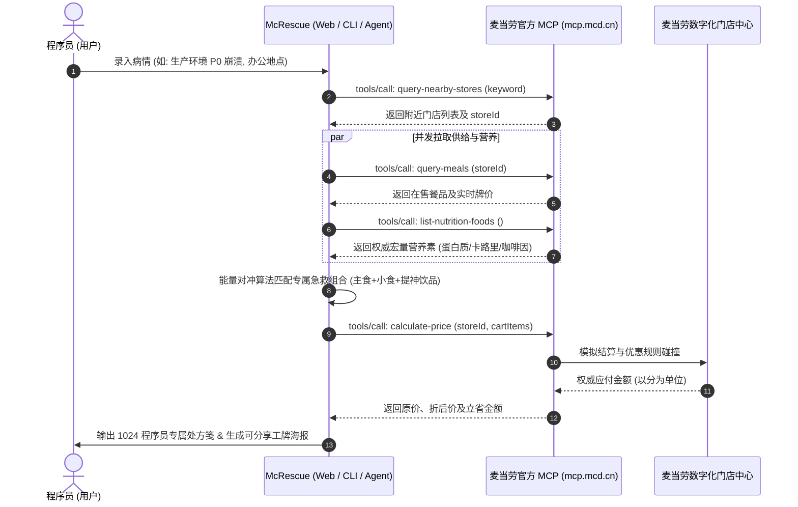

# MCP_INTEGRATION.md · 麦当劳官方 MCP 集成说明文档

本项目 **McRescue（麦门代码急救站）** 作为麦当劳程序员创意开发大赛参赛作品，深度集成了麦当劳中国官方提供的 **Model Context Protocol (MCP)** 服务体系。以下为实际使用的 MCP Server、工具集、调用时序及业务价值说明。

---

## 1. 使用的 MCP Server 基础信息

- **服务名称**：麦当劳中国官方 MCP 生产服务 (McDonald's China MCP Server)
- **服务根地址**：`https://mcp.mcd.cn`
- **通信协议**：Streamable HTTP（基于 HTTP/1.1 与 HTTP/2 的长连接/流式响应）
- **数据格式**：标准 JSON-RPC 2.0 协议规范
- **鉴权机制**：`Authorization: Bearer <MCD_MCP_TOKEN>`
- **Token 申请渠道**：用户通过麦当劳开放平台控制台（[open.mcd.cn/mcp](https://open.mcd.cn/mcp)）手机号实名认证申请

---

## 2. 真实调用的 MCP Tools 说明

本项目所有 MCP 调用均为**只读、核验与决策辅助**性质，严格遵循安全边界，不擅自产生未授权扣费或下单：

| 工具名称 (Tool Name) | 调用用途 | 输入参数 | 业务逻辑与输出价值 |
|---|---|---|---|
| `query-nearby-stores` | 门店近场检索 | `keyword: str`（如“中关村”、“张江”、“科兴”） | 获取离程序员办公地点最近的真实在售门店，解析其 `storeId` 与详细地址 |
| `query-meals` | 在售餐品清单检索 | `storeId: str` | 抓取该门店当前实际供应的汉堡、小食、饮品列表及其单品售价 |
| `list-nutrition-foods` | 权威营养与热量对标 | 无 | 获取食品维度的真实卡路里 (kcal)、蛋白质 (g)、碳水化合物 (g) 与咖啡因 (mg) 含量 |
| `query-store-coupons` | 门店专享优惠券检索 | `storeId: str` | 探测门店生效中的 1+1 随心配、超值三件套等满减优惠 |
| `calculate-price` | 官方购物车精准核价 | `storeId: str`, `items: list` | 模拟将诊断匹配的餐品放入购物车，由麦当劳后台执行精准折扣折让计算（返回值单位：分） |

---

## 3. 调用流程与数据时序 (Call Flow)

本项目将程序员的高频困境（P0 宕机、Git 冲突、需求突变、深夜加班）抽象为身体机能与精神状态的诊断，整体交互链路如下：

---

## 4. 敏感信息与安全脱敏声明

1. **零 Token 泄露**：本项目所有源代码、文档、提交记录及演示工程中，**严禁硬编码任何真实 MCP Token**。
2. **安全占位符**：示例配置文件严格遵循规范，仅使用 `${MCD_MCP_TOKEN}` 环境变量占位。
3. **前端安全原则**：Web 端在 Live 模式下输入的 Token 仅保留于当前浏览会话的内存堆中，不写入 `localStorage`/`Cookie`，绝不上报给任何第三方服务器。
4. **安全兜底支持**：未配置 Token 时，项目自动启用内置高保真 Mock 镜像引擎，确保离线评审与本地调试 100% 顺畅。

---

## 5. 业务价值与麦当劳生态赋能

1. **激活程序员高净值群体**：将 1024 程序员节的文化痛点（Oncall 熬夜、Bug 修复、算力透支）与麦当劳餐品的高多巴胺、高蛋白、高性价比（1+1随心配）完美绑定。
2. **权威科学膳食引导**：通过 MCP 营养接口打破“快餐不健康”的刻板印象，针对久坐运动量少的极客提供板烧去酱+纯黑咖啡的科学健康配比。
3. **传播性与社交裂变**：自动生成极具极客美学与麦当劳金拱门元素的“麦门工牌海报”，激发开发者在技术社群、微信朋友圈与 GitHub 上的自发分享与互动。
